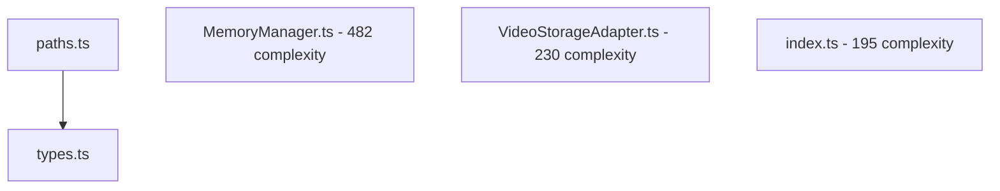

# LLM Memory MCP - Code Analysis & Improvement Report

**Generated:** 2025-10-11
**Analysis Method:** Automated code analysis tools + manual review
**Repository Version:** 1.0.0

This document provides a comprehensive analysis of the codebase with prioritized recommendations for improvements, bugfixes, and new features. It complements the existing [IMPROVEMENTS_AND_FEATURES.md](./IMPROVEMENTS_AND_FEATURES.md) by focusing on code quality, architecture, and immediate actionable items discovered through static analysis.

## Executive Summary

**Codebase Health: 7.5/10**

### Strengths
- ✅ **Zero circular dependencies** - Excellent architecture hygiene
- ✅ **Comprehensive error handling** - 187 try-catch blocks throughout codebase
- ✅ **Revolutionary video storage** - 50-100x compression with sub-100ms search
- ✅ **Well-documented** - Extensive documentation in multiple formats
- ✅ **Recent feature additions** - TTL pruning, incremental editing, optimized journaling

### Critical Issues
- ❌ **Extreme code complexity** - MemoryManager.ts has cyclomatic complexity of 482
- ❌ **Code duplication** - Two ULID implementations, one unused path utility
- ❌ **Missing unit tests** - Only integration tests exist, no module-level tests
- ❌ **High coupling in core modules** - Some modules exceed 200+ lines of complexity

### Metrics Overview
```
Total Files:            38
Total Lines:            16,570
Average Complexity:     51.4
Max Complexity:         482 (MemoryManager.ts)
Test Coverage:          Integration only (no unit tests)
Dependencies:           Very low coupling (1 edge detected)
```

---

## Priority 1: Critical Code Quality Issues

### 1.1 Refactor MemoryManager.ts (Complexity: 482)

**Status:** 🔴 Critical
**Impact:** High - Core functionality, maintainability, testing
**Effort:** Large (2-3 days)

**Problem:**
`MemoryManager.ts` has a cyclomatic complexity of 482, making it:
- Extremely difficult to test comprehensively
- Hard to understand and maintain
- Prone to bugs due to cognitive overload
- Difficult to extend with new features

**Current Structure:**
- 1,726 lines in a single class
- 14 imports
- Handles: storage, indexing, vectors, caching, timers, watchers, confidence scoring, TTL, compaction

**Recommended Refactoring:**

```typescript
// Current monolithic structure
class MemoryManager {
  // Storage management
  // Index management
  // Vector management
  // Cache management
  // Timer management
  // Confidence scoring
  // Journal operations
  // Sync operations
  // Context pack generation
  // ... 1,700+ lines
}

// Proposed modular structure
class MemoryManager {
  private storage: StorageCoordinator;
  private search: SearchManager;
  private confidence: ConfidenceScorer;
  private sync: SyncManager;
  private lifecycle: LifecycleManager;
}

// New modules
class StorageCoordinator {
  // Manages stores, adapters, backend detection
}

class SearchManager {
  // Manages indexers, vectors, query cache
}

class ConfidenceScorer {
  // All confidence-related logic (lines 69-232)
}

class SyncManager {
  // Sync status, merge operations (lines 1355-1403)
}

class LifecycleManager {
  // Timers, watchers, compaction, snapshots (lines 44-67, 1162-1724)
}
```

**Benefits:**
- Each module under 300 lines
- Testable in isolation
- Clear separation of concerns
- Easier onboarding for new developers

**Files to Create:**
- `src/memory/StorageCoordinator.ts`
- `src/memory/SearchManager.ts`
- `src/memory/ConfidenceScorer.ts`
- `src/memory/SyncManager.ts`
- `src/memory/LifecycleManager.ts`

---

### 1.2 Consolidate ULID Implementations

**Status:** 🟡 High
**Impact:** Medium - Code clarity, dependency management
**Effort:** Small (2-4 hours)

**Problem:**
Two ULID implementations exist:

| File | Lines | Usage | Features |
|------|-------|-------|----------|
| `src/util/ulid.ts` | 56 | **9 files** | Crypto-based (secure), monotonic |
| `src/utils/ULID.ts` | 79 | 1 file | Math.random (less secure), has `extractTime()`, `isValidULID()` |

**Recommended Action:**

1. **Migrate to `src/util/ulid.ts`** (it's more widely used and crypto-based)
2. **Add missing utilities from `src/utils/ULID.ts`:**

```typescript
// Add to src/util/ulid.ts
export function extractTime(ulidString: string): number {
  if (ulidString.length !== 26) {
    throw new Error('Invalid ULID format');
  }
  const Crock = '0123456789ABCDEFGHJKMNPQRSTVWXYZ';
  let time = 0;
  for (let i = 0; i < 10; i++) {
    const char = ulidString[i];
    const index = Crock.indexOf(char);
    if (index === -1) {
      throw new Error('Invalid ULID character');
    }
    time = time * 32 + index;
  }
  return time;
}

export function isValidULID(ulidString: string): boolean {
  try {
    extractTime(ulidString);
    return ulidString.length === 26;
  } catch {
    return false;
  }
}
```

3. **Update `KnowledgeStore.ts`** (only file using `src/utils/ULID.ts`):

```typescript
// Change:
import { ulid } from '../utils/ULID.js';
// To:
import { ulid, extractTime, isValidULID } from '../util/ulid.js';
```

4. **Delete `src/utils/ULID.ts`**

---

### 1.3 Remove Dead Code

**Status:** 🟢 Low
**Impact:** Low - Code cleanliness
**Effort:** Trivial (15 minutes)

**Problem:**
`src/storage/paths.ts` has zero imports - completely unused.

**Action:**
```bash
# Verify no imports
grep -r "from.*storage/paths" src/

# Remove file
rm src/storage/paths.ts
```

**Note:** `src/paths.ts` is the actively used version.

---

### 1.4 Add Unit Tests for Core Modules

**Status:** 🔴 Critical
**Impact:** High - Code quality, regression prevention
**Effort:** Large (1-2 weeks)

**Problem:**
Only integration tests exist. No unit tests for critical modules:

**Untested High-Complexity Modules:**

| Module | Complexity | Lines | Test File Needed |
|--------|-----------|-------|------------------|
| MemoryManager.ts | 482 | 1,726 | `tests/unit/MemoryManager.test.ts` |
| VideoStorageAdapter.ts | 230 | 1,561 | `tests/unit/VideoStorageAdapter.test.ts` |
| index.ts (MCP Server) | 195 | 1,780 | `tests/unit/MCPServer.test.ts` |
| VideoDecoder.ts | 114 | 705 | `tests/unit/VideoDecoder.test.ts` |
| NativeEncoder.ts | 93 | 830 | `tests/unit/NativeEncoder.test.ts` |
| QRDecoder.ts | 73 | 763 | `tests/unit/QRDecoder.test.ts` |

**Recommended Test Structure:**

```
tests/
├── unit/
│   ├── memory/
│   │   ├── MemoryManager.test.ts
│   │   ├── ConfidenceScorer.test.ts
│   │   └── StorageCoordinator.test.ts
│   ├── storage/
│   │   ├── FileStorageAdapter.test.ts
│   │   ├── VideoStorageAdapter.test.ts
│   │   ├── Indexer.test.ts
│   │   └── VectorIndex.test.ts
│   ├── video/
│   │   ├── NativeEncoder.test.ts
│   │   ├── WasmEncoder.test.ts
│   │   ├── VideoDecoder.test.ts
│   │   └── FrameExtractor.test.ts
│   ├── qr/
│   │   ├── QRManager.test.ts
│   │   └── QRDecoder.test.ts
│   └── utils/
│       ├── ulid.test.ts
│       ├── secretFilter.test.ts
│       └── tokenEstimate.test.ts
├── integration/  (existing)
└── e2e/  (existing)
```

**Priority Test Coverage:**

1. **ConfidenceScorer** - Complex algorithm, critical for search quality
2. **VideoStorageAdapter** - High complexity, data integrity critical
3. **Indexer** - BM25 search correctness
4. **QRDecoder** - Data integrity, 99.7% decode rate verification
5. **ULID generation** - Monotonicity, uniqueness

**Sample Test (ConfidenceScorer):**

```typescript
// tests/unit/memory/ConfidenceScorer.test.ts
import { describe, it, expect } from '@jest/globals';
import { ConfidenceScorer } from '../../../src/memory/ConfidenceScorer';

describe('ConfidenceScorer', () => {
  describe('computeConfidence', () => {
    it('should return base prior for new item with no signals', () => {
      const scorer = new ConfidenceScorer({ basePrior: 0.5 });
      const item = createMemoryItem({ quality: {} });
      const confidence = scorer.compute(item, new Date());
      expect(confidence).toBeCloseTo(0.5, 2);
    });

    it('should increase confidence with positive feedback', () => {
      const scorer = new ConfidenceScorer();
      const item = createMemoryItem({
        quality: { helpfulCount: 10, notHelpfulCount: 2 }
      });
      const confidence = scorer.compute(item, new Date());
      expect(confidence).toBeGreaterThan(0.5);
    });

    it('should apply exponential decay to usage', () => {
      // Test time decay logic
    });

    it('should respect pin floor and multiplier', () => {
      // Test pinned item handling
    });
  });
});
```

---

## Priority 2: High-Priority Improvements

### 2.1 Markdown Storage Backend & Obsidian Integration

**Status:** 🟡 High
**Impact:** High - New storage format, knowledge graph integration
**Effort:** Large (2-3 weeks)

**Overview:**
Add markdown as a first-class storage backend alongside JSON and video, with optional Obsidian vault integration for seamless knowledge management workflows.

**Storage Backend Architecture:**

```typescript
// Updated storage backend types
type StorageBackend = 'json' | 'video' | 'markdown';

// Storage configuration
interface StorageConfig {
  backend: StorageBackend;
  jsonOptions?: {
    // Existing file storage options
  };
  videoOptions?: {
    codec: 'h264' | 'h265';
    // ... existing video options
  };
  markdownOptions?: {
    enabled: boolean;
    format: 'frontmatter' | 'inline' | 'hybrid';
    useObsidian?: {
      enabled: boolean;
      vaultPath: string;
      memoryFolder: string;  // e.g., "Memory/LLM"
      templatePath?: string;
      autoLink: boolean;
      syncOnChange: boolean;
    };
    linking: {
      style: 'wikilink' | 'markdown';
      autoBacklinks: boolean;
      resolvePaths: boolean;
    };
  };
}
```

**Markdown Storage Format:**

```markdown
---
id: 01HXYZ...
type: snippet
scope: local
title: React Error Boundary Pattern
language: typescript
tags:
  - react
  - error-handling
  - typescript
files:
  - src/components/ErrorBoundary.tsx
symbols:
  - ErrorBoundary
confidence: 0.85
pinned: false
createdAt: 2025-10-11T10:30:00Z
updatedAt: 2025-10-11T14:20:00Z
version: 3
---

# React Error Boundary Pattern

Error boundaries catch JavaScript errors in child components and display fallback UI instead of crashing the entire component tree.

## Implementation

```typescript
class ErrorBoundary extends React.Component<Props, State> {
  static getDerivedStateFromError(error: Error) {
    return { hasError: true, error };
  }

  componentDidCatch(error: Error, errorInfo: ErrorInfo) {
    logErrorToService(error, errorInfo);
  }

  render() {
    if (this.state.hasError) {
      return <FallbackUI error={this.state.error} />;
    }
    return this.props.children;
  }
}
```

## Related Memories

- [[Error Recovery Strategies]]
- [[React Component Patterns]]
- [[Logging Best Practices]]

## Context

- **Repository:** my-react-app
- **File:** src/components/ErrorBoundary.tsx
- **Lines:** 10-45

## Quality Metrics

- **Reuse Count:** 5
- **Helpful Feedback:** 8 helpful, 1 not helpful
- **Last Used:** 2025-10-10T16:45:00Z
```

**Obsidian Integration Features:**

1. **Vault Synchronization**
   ```typescript
   class ObsidianStorageAdapter implements StorageAdapter {
     private vaultPath: string;
     private memoryFolder: string;
     private obsidianAPI: ObsidianAPI;

     async writeItem(item: MemoryItem): Promise<void> {
       // Convert MemoryItem to markdown with frontmatter
       const markdown = this.itemToMarkdown(item);

       // Write to Obsidian vault
       const filePath = path.join(
         this.vaultPath,
         this.memoryFolder,
         `${item.id}.md`
       );

       // Use Obsidian API for proper file handling
       await this.obsidianAPI.vault.create(filePath, markdown);

       // Trigger Obsidian to index the file
       await this.obsidianAPI.vault.trigger('modify', filePath);
     }

     async readItem(id: string): Promise<MemoryItem | null> {
       // Read from Obsidian vault
       const filePath = this.getFilePath(id);
       const content = await this.obsidianAPI.vault.read(filePath);

       // Parse frontmatter + markdown body
       return this.markdownToItem(content);
     }
   }
   ```

2. **Wikilink Resolution**
   ```typescript
   class WikilinkResolver {
     resolveLinks(item: MemoryItem): MemoryLink[] {
       const text = item.text || '';
       const wikilinks = text.match(/\[\[(.*?)\]\]/g) || [];

       return wikilinks.map(link => ({
         rel: 'relates',
         to: this.resolveWikilinkToId(link),
         title: this.extractLinkTitle(link)
       }));
     }

     async createBacklinks(item: MemoryItem): Promise<void> {
       // Find all memories that link to this one
       // Add backlink section to those memories
     }
   }
   ```

3. **Obsidian Graph Integration**
   ```typescript
   // Enable Obsidian graph view for memory relationships
   interface ObsidianGraphNode {
     id: string;
     title: string;
     type: MemoryType;
     color: string;
     size: number; // Based on confidence/reuse
   }

   interface ObsidianGraphEdge {
     source: string;
     target: string;
     type: MemoryLink['rel'];
   }
   ```

4. **Template Support**
   ```markdown
   <!-- .obsidian/templates/memory-snippet.md -->
   ---
   type: snippet
   scope: local
   tags: []
   language: {{language}}
   ---

   # {{title}}

   ## Description

   {{cursor}}

   ## Code

   ```{{language}}

   ```

   ## Related Memories


   ## Context

   - **File:**
   - **Lines:**
   ```

**Migration Strategy:**

1. **Rename `file` backend to `json`:**
   ```typescript
   // Backward compatibility
   function normalizeBackend(backend: string): StorageBackend {
     if (backend === 'file') {
       console.warn('Storage backend "file" is deprecated, use "json"');
       return 'json';
     }
     return backend as StorageBackend;
   }
   ```

2. **Auto-detection priority:**
   ```typescript
   function detectStorageBackend(dir: string): StorageBackend {
     // Check config.json first
     const config = readConfig(dir);
     if (config?.storage?.backend) {
       return normalizeBackend(config.storage.backend);
     }

     // Check for Obsidian vault structure
     if (hasObsidianVault(dir)) {
       return 'markdown';
     }

     // Check for video segments
     if (hasVideoSegments(dir)) {
       return 'video';
     }

     // Check for markdown files
     if (hasMarkdownFiles(dir)) {
       return 'markdown';
     }

     // Default to JSON
     return 'json';
   }
   ```

**Storage Layout (Markdown):**

```
<scope-root>/
  memories/
    01HXYZ-snippet-react-error-boundary.md
    01HABC-pattern-authentication-flow.md
    01HDEF-config-eslint-rules.md
  .memory/
    catalog.json          # Still maintained for fast search
    index/
      inverted.json       # BM25 index
      backlinks.json      # Wikilink backlink map
      graph.json          # Graph structure for visualization
    config.json
  .obsidian/              # If using Obsidian
    templates/
      memory-snippet.md
      memory-pattern.md
```

**Obsidian Plugin Integration:**

```typescript
// Obsidian plugin manifest
{
  "id": "llm-memory-mcp",
  "name": "LLM Memory MCP Integration",
  "version": "1.0.0",
  "minAppVersion": "1.0.0",
  "description": "Integrate LLM Memory MCP server with Obsidian vault",
  "author": "LLM Memory MCP",
  "isDesktopOnly": false
}

// Plugin main class
class LLMMemoryPlugin extends Plugin {
  async onload() {
    // Register commands
    this.addCommand({
      id: 'create-memory-snippet',
      name: 'Create Memory: Snippet',
      callback: () => this.createMemoryFromTemplate('snippet')
    });

    // Register file watcher
    this.registerEvent(
      this.app.vault.on('modify', (file) => {
        if (this.isMemoryFile(file)) {
          this.syncToMCP(file);
        }
      })
    );

    // Register graph view
    this.registerView(
      'memory-graph',
      (leaf) => new MemoryGraphView(leaf)
    );
  }
}
```

**New MCP Tools:**

```json
[
  {
    "name": "memory.exportToMarkdown",
    "description": "Export memories to markdown format",
    "arguments": {
      "scope": "MemoryScope",
      "outputDir": "string",
      "format": "'frontmatter' | 'inline' | 'hybrid'",
      "includeBacklinks": "boolean"
    }
  },
  {
    "name": "memory.importFromMarkdown",
    "description": "Import memories from markdown files",
    "arguments": {
      "inputDir": "string",
      "scope": "MemoryScope",
      "parseWikilinks": "boolean",
      "createBacklinks": "boolean"
    }
  },
  {
    "name": "memory.syncWithObsidian",
    "description": "Sync memories with Obsidian vault",
    "arguments": {
      "vaultPath": "string",
      "direction": "'bidirectional' | 'to-obsidian' | 'from-obsidian'",
      "scope": "MemoryScope"
    }
  },
  {
    "name": "memory.getGraph",
    "description": "Get memory relationship graph",
    "arguments": {
      "scope": "MemoryScope",
      "format": "'json' | 'mermaid' | 'obsidian'"
    }
  }
]
```

**Benefits:**

1. **Human-Readable Storage** - Markdown files can be read/edited directly
2. **Knowledge Graph** - Wikilinks create natural relationship graph
3. **Obsidian Integration** - Use full Obsidian feature set (graph view, backlinks, search)
4. **Git-Friendly** - Markdown diffs are much cleaner than JSON
5. **Template Support** - Standardize memory creation
6. **Dual Access** - Edit in Obsidian or via MCP tools
7. **Portability** - Standard markdown format, not vendor-locked

**Implementation Phases:**

**Phase 1: Core Markdown Support (Week 1-2)**
- [ ] Implement MarkdownStorageAdapter
- [ ] Frontmatter parser/serializer
- [ ] Markdown ↔ MemoryItem conversion
- [ ] Wikilink detection and parsing
- [ ] Update storage backend detection

**Phase 2: Linking & Backlinks (Week 2-3)**
- [ ] WikilinkResolver implementation
- [ ] Automatic backlink generation
- [ ] Link validation and repair
- [ ] Graph structure generation

**Phase 3: Obsidian Integration (Week 3-4)**
- [ ] Obsidian API integration
- [ ] Vault detection and configuration
- [ ] File watcher for bi-directional sync
- [ ] Template system integration

**Phase 4: Migration Tools (Week 4)**
- [ ] JSON → Markdown migration
- [ ] Video → Markdown migration
- [ ] Bulk import/export tools
- [ ] Validation and integrity checks

**Testing Strategy:**

```bash
# Unit tests
pnpm run test:unit:markdown           # Markdown parser/serializer
pnpm run test:unit:wikilinks          # Wikilink resolution
pnpm run test:unit:obsidian           # Obsidian integration

# Integration tests
pnpm run test:integration:markdown    # End-to-end markdown storage
pnpm run test:integration:obsidian    # Obsidian vault sync

# Migration tests
pnpm run test:migration:to-markdown   # JSON/Video → Markdown
pnpm run test:migration:obsidian      # Obsidian vault import
```

**Configuration Example:**

```json
{
  "storage": {
    "backend": "markdown",
    "markdownOptions": {
      "enabled": true,
      "format": "frontmatter",
      "useObsidian": {
        "enabled": true,
        "vaultPath": "/Users/user/Documents/ObsidianVault",
        "memoryFolder": "Memory/LLM",
        "templatePath": ".obsidian/templates/memory",
        "autoLink": true,
        "syncOnChange": true
      },
      "linking": {
        "style": "wikilink",
        "autoBacklinks": true,
        "resolvePaths": true
      }
    }
  }
}
```

---

### 2.2 Reduce VideoStorageAdapter Complexity (230)

**Status:** 🟡 High
**Impact:** Medium - Maintainability, video storage reliability
**Effort:** Medium (3-5 days)

**Problem:**
VideoStorageAdapter.ts has complexity 230 across 1,561 lines.

**Recommended Refactoring:**

```typescript
// Extract sub-modules:
class VideoStorageAdapter {
  private frameManager: VideoFrameManager;
  private cacheManager: VideoCacheManager;
  private catalogManager: CatalogManager;
  private indexBridge: IndexBridge;
}

// New classes
class VideoFrameManager {
  // Frame encoding/decoding
  // QR management
  // Frame index operations
}

class VideoCacheManager {
  // Payload cache
  // Frame cache
  // Cache statistics
}

class CatalogManager {
  // Catalog rebuild
  // Catalog synchronization
  // Summary generation
}

class IndexBridge {
  // Search index integration
  // Index update callbacks
  // Callback registration
}
```

---

### 2.2 Add Performance Monitoring & Metrics

**Status:** 🟡 High
**Impact:** High - Observability, optimization opportunities
**Effort:** Medium (2-3 days)

**Problem:**
No built-in performance monitoring for production use.

**Recommended Addition:**

```typescript
// src/monitoring/PerformanceMonitor.ts
export class PerformanceMonitor {
  private metrics: Map<string, MetricData>;

  recordOperation(name: string, duration: number, metadata?: any): void;
  recordCacheHit(scope: string, cacheType: string): void;
  recordCacheMiss(scope: string, cacheType: string): void;
  recordError(operation: string, error: Error): void;

  getMetrics(): PerformanceMetrics;
  resetMetrics(): void;
}

interface PerformanceMetrics {
  operations: {
    [key: string]: {
      count: number;
      avgDuration: number;
      p50: number;
      p95: number;
      p99: number;
      errors: number;
    };
  };
  caches: {
    [scope: string]: {
      hitRate: number;
      totalAccesses: number;
    };
  };
  memory: {
    heapUsed: number;
    heapTotal: number;
    external: number;
  };
}
```

**Integration Points:**
- `MemoryManager.query()` - Track search performance
- `VideoStorageAdapter.readItem()` - Track decode performance
- `ConfidenceScorer.compute()` - Track confidence calculation
- Cache hit/miss tracking in all caches

**New MCP Tool:**
```json
{
  "name": "monitoring.metrics",
  "description": "Get performance metrics and statistics",
  "arguments": {
    "reset": { "type": "boolean", "description": "Reset metrics after reading" }
  }
}
```

---

### 2.3 Implement Memory Item Versioning/History

**Status:** 🟡 High
**Impact:** Medium - Data integrity, audit trail
**Effort:** Medium (3-4 days)

**Problem:**
No history tracking for memory item changes. Version number increments but previous versions are lost.

**Recommended Feature:**

```typescript
interface MemoryItemHistory {
  id: string;
  version: number;
  item: MemoryItem;
  changedAt: string;
  changedBy: string;
  changeType: 'create' | 'update' | 'delete';
  diff?: {
    field: string;
    oldValue: any;
    newValue: any;
  }[];
}

// Storage layout
<scope-root>/
  history/
    <id>/
      v1.json
      v2.json
      v3.json
```

**New MCP Tools:**
```json
[
  {
    "name": "memory.getHistory",
    "description": "Get version history for a memory item",
    "arguments": {
      "id": "string",
      "scope": "MemoryScope",
      "limit": "number"
    }
  },
  {
    "name": "memory.revert",
    "description": "Revert memory item to previous version",
    "arguments": {
      "id": "string",
      "version": "number",
      "scope": "MemoryScope"
    }
  }
]
```

**Configuration:**
```json
{
  "versioning": {
    "enabled": true,
    "maxVersionsPerItem": 10,
    "compressOldVersions": true,
    "retentionDays": 90
  }
}
```

---

### 2.4 Enhanced Error Messages & Diagnostics

**Status:** 🟡 High
**Impact:** Medium - Developer experience, debugging
**Effort:** Small (1-2 days)

**Problem:**
Many error messages lack context for troubleshooting.

**Improvements:**

```typescript
// Current
throw new Error('Migration failed');

// Improved
throw new McpError(
  ErrorCode.InternalError,
  `Video storage migration failed: ${reason}\n\n` +
  `Context:\n` +
  `  Source: ${sourceBackend}\n` +
  `  Target: ${targetBackend}\n` +
  `  Scope: ${scope}\n` +
  `  Items processed: ${processed}/${total}\n` +
  `  Failed item ID: ${failedId}\n\n` +
  `Remediation:\n` +
  `  1. Check FFmpeg installation: ffmpeg -version\n` +
  `  2. Validate storage backend: migration.status\n` +
  `  3. Check disk space and permissions\n` +
  `  4. Review logs at: ${logPath}`
);
```

**Add Error Catalog:**
```typescript
// src/errors/ErrorCatalog.ts
export const ErrorCatalog = {
  MIGRATION_FAILED: {
    code: 'E_MIGRATION_001',
    message: 'Storage backend migration failed',
    remediation: [
      'Check FFmpeg installation',
      'Validate storage backend',
      'Check disk space'
    ]
  },
  // ... more errors
};
```

---

## Priority 3: Medium-Priority Enhancements

### 3.1 CLI Improvements

**Status:** 🟢 Medium
**Impact:** Medium - Developer experience
**Effort:** Medium (2-3 days)

**Current CLI:**
```bash
llm-memory-migrate storage  # Basic migration
llm-memory-migrate scope    # Scope migration
```

**Enhanced CLI:**
```bash
# Interactive mode
llm-memory interactive

# Query from CLI
llm-memory query "react hooks" --scope project --k 10

# Statistics
llm-memory stats --scope all

# Health check
llm-memory health

# Export/Import
llm-memory export --scope local --output backup.json
llm-memory import --scope local --input backup.json

# Maintenance
llm-memory compact --scope all
llm-memory rebuild-index --scope project
```

---

### 3.2 Context Pack Enhancements

**Status:** 🟢 Medium
**Impact:** Medium - LLM integration quality
**Effort:** Small (1-2 days)

**Improvements:**

1. **Smart Snippet Selection**
   - Prioritize snippets by confidence + relevance
   - Avoid redundant code patterns
   - Group related snippets

2. **Symbol-Aware Cropping**
   - Already implemented, enhance with better detection
   - Add JSDoc/TSDoc preservation
   - Include type signatures

3. **Context Pack Templates**
   ```typescript
   interface ContextPackTemplate {
     name: string;
     description: string;
     sections: {
       type: MemoryType[];
       weight: number;
       maxItems: number;
     }[];
   }

   // Predefined templates
   const TEMPLATES = {
     bugfix: {
       // Prioritize patterns, insights, related code
     },
     feature: {
       // Prioritize patterns, configs, examples
     },
     refactor: {
       // Prioritize patterns, architecture docs
     }
   };
   ```

---

### 3.3 Batch Operations

**Status:** 🟢 Medium
**Impact:** Medium - Performance for bulk operations
**Effort:** Small (2-3 days)

**New Tools:**

```json
[
  {
    "name": "memory.upsertBatch",
    "description": "Batch upsert multiple memory items",
    "arguments": {
      "items": "MemoryItem[]",
      "atomic": "boolean"
    }
  },
  {
    "name": "memory.deleteBatch",
    "description": "Batch delete multiple memory items",
    "arguments": {
      "ids": "string[]",
      "scope": "MemoryScope"
    }
  },
  {
    "name": "memory.tagBatch",
    "description": "Batch tag operations on multiple items",
    "arguments": {
      "ids": "string[]",
      "add": "string[]",
      "remove": "string[]"
    }
  }
]
```

---

### 3.4 Query Language Enhancements

**Status:** 🟢 Medium
**Impact:** Medium - Search power
**Effort:** Medium (3-4 days)

**Current Query:**
```json
{
  "q": "react hooks",
  "filters": {
    "type": ["snippet"],
    "tags": ["react"]
  }
}
```

**Enhanced Query DSL:**
```
// Boolean operators
react AND hooks

// Field-specific search
title:"error boundary" OR text:fallback

// Date ranges
updatedAt:[2025-01-01 TO 2025-12-31]

// Confidence filtering
confidence:>0.8

// Negation
react NOT deprecated

// Wildcards
react-use-*

// Proximity
"authentication flow"~5
```

**Implementation:**
```typescript
// src/query/QueryParser.ts
export class QueryParser {
  parse(query: string): ParsedQuery {
    // Parse DSL into structured query
  }
}
```

---

## Priority 4: Nice-to-Have Features

### 4.1 Learn-from-Diffs Integration

**Status:** 🟢 Low
**Impact:** Low - Automation
**Effort:** Medium (3-4 days)

**Feature:**
Automatically capture code changes and generate insights.

```typescript
// Git hook integration
interface DiffLearning {
  enabled: boolean;
  patterns: {
    minDiffSize: number;
    excludePatterns: string[];
    captureTypes: ('bugfix' | 'feature' | 'refactor')[];
  };
  autoGenerate: {
    insights: boolean;
    patterns: boolean;
    runbooks: boolean;
  };
}
```

**Usage:**
```bash
# In .git/hooks/post-commit
llm-memory learn-from-diff HEAD~1 HEAD --auto-categorize
```

---

### 4.2 Web UI for Memory Browsing

**Status:** 🟢 Low
**Impact:** Low - Convenience
**Effort:** Large (1-2 weeks)

**Feature:**
Lightweight read-only web interface.

```bash
llm-memory serve --port 3000

# Opens browser at http://localhost:3000
# - Browse memories by scope/type/tags
# - Search with live preview
# - View context packs
# - Export selections
```

---

### 4.3 Smart Auto-Learning Hooks

**Status:** 🟢 Low
**Impact:** Low - Automation
**Effort:** Medium (3-5 days)

**Feature:**
Auto-capture from IDE/LSP events.

```typescript
interface AutoLearnConfig {
  enabled: boolean;
  triggers: {
    onSuccessfulFix: boolean;
    onAcceptedRefactor: boolean;
    onReusedSnippet: boolean;
  };
  filters: {
    minConfidence: number;
    requireUserApproval: boolean;
  };
}
```

---

## Implementation Roadmap

### Phase 1: Critical Fixes (Week 1-2)
- [ ] Consolidate ULID implementations
- [ ] Remove dead code (paths.ts)
- [ ] Begin MemoryManager refactoring
  - [ ] Extract ConfidenceScorer
  - [ ] Extract StorageCoordinator

### Phase 2: Testing Infrastructure (Week 3-4)
- [ ] Set up unit test framework
- [ ] Add tests for ConfidenceScorer
- [ ] Add tests for ULID utilities
- [ ] Add tests for Indexer (BM25)
- [ ] Add tests for QRDecoder

### Phase 3: MemoryManager Refactoring (Week 5-6)
- [ ] Extract SearchManager
- [ ] Extract SyncManager
- [ ] Extract LifecycleManager
- [ ] Update integration tests
- [ ] Performance regression testing

### Phase 4: Markdown Storage & Obsidian Integration (Week 7-10)
- [ ] Implement MarkdownStorageAdapter
- [ ] Frontmatter parser/serializer
- [ ] Wikilink resolution and backlinks
- [ ] Obsidian API integration
- [ ] Vault synchronization (bidirectional)
- [ ] Template system
- [ ] Migration tools (JSON/Video → Markdown)
- [ ] Graph visualization
- [ ] Obsidian plugin development

### Phase 5: High-Priority Features (Week 11-13)
- [ ] Implement performance monitoring
- [ ] Add memory item versioning/history
- [ ] Enhance error messages with diagnostics
- [ ] Reduce VideoStorageAdapter complexity

### Phase 6: Medium-Priority Enhancements (Week 14-16)
- [ ] CLI improvements
- [ ] Context pack enhancements
- [ ] Batch operations
- [ ] Query language DSL

### Phase 7: Nice-to-Have Features (Week 17+)
- [ ] Learn-from-diffs
- [ ] Web UI
- [ ] Auto-learning hooks

---

## Testing Strategy

### Unit Tests
```bash
pnpm run test:unit                    # All unit tests
pnpm run test:unit:memory            # Memory module tests
pnpm run test:unit:storage           # Storage tests
pnpm run test:unit:video             # Video storage tests
pnpm run test:unit:coverage          # With coverage report
```

### Integration Tests
```bash
pnpm run test:integration            # Existing integration tests
pnpm run test:parity                # Storage parity validation
pnpm run test:migration             # Migration validation
```

### Performance Tests
```bash
pnpm run test:performance           # Performance benchmarks
pnpm run benchmark                  # Comprehensive benchmark
pnpm run benchmark:fast             # Quick benchmark
```

---

## Metrics & Success Criteria

### Code Quality Targets
- [ ] Max file complexity: **<150** (currently 482)
- [ ] Unit test coverage: **>80%** (currently 0%)
- [ ] Integration test coverage: **>90%** (currently ~70%)
- [ ] No duplicate code (ULID fixed)
- [ ] No dead code (paths.ts removed)

### Performance Targets
- [ ] Query response time: **<100ms** (P95)
- [ ] Video decode: **<50ms** (P95)
- [ ] Index rebuild: **<5s** for 10k items
- [ ] Cache hit rate: **>80%**

### Reliability Targets
- [ ] Zero data loss during migration
- [ ] QR decode success: **>99.7%**
- [ ] Journal integrity: **100%** verified
- [ ] Startup recovery: **<2s** for 10k items

---

## Conclusion

This analysis reveals a codebase with **excellent architecture** (no circular dependencies), **innovative features** (video storage), and **comprehensive documentation**, but suffering from:

1. **Extreme complexity concentration** in MemoryManager
2. **Missing unit test coverage**
3. **Minor code duplication**

**Recommended Focus:**
1. **Refactor MemoryManager** into smaller, testable modules
2. **Build comprehensive unit test suite**
3. **Implement Markdown storage & Obsidian integration** (new high-priority feature)
4. **Add performance monitoring**
5. **Enhance error diagnostics**

The video storage implementation is production-ready, but the core MemoryManager needs refactoring before major feature additions. The markdown storage backend will provide a human-readable, git-friendly alternative with powerful knowledge graph capabilities through Obsidian integration.

**Estimated Total Effort:** 16-18 weeks for Phase 1-7 (extended for markdown/Obsidian features)

---

## Appendix A: File Complexity Report

### Top 10 Most Complex Files

| Rank | File | Complexity | Lines | Recommendation |
|------|------|-----------|-------|----------------|
| 1 | MemoryManager.ts | 482 | 1,726 | 🔴 **Refactor immediately** |
| 2 | VideoStorageAdapter.ts | 230 | 1,561 | 🟡 **Refactor soon** |
| 3 | index.ts (MCP Server) | 195 | 1,780 | 🟡 **Consider extraction** |
| 4 | VideoDecoder.ts | 114 | 705 | 🟢 Acceptable |
| 5 | NativeEncoder.ts | 93 | 830 | 🟢 Acceptable |
| 6 | fileStore.ts | 79 | 865 | 🟢 Acceptable |
| 7 | MigrationManager.ts | 77 | 692 | 🟢 Acceptable |
| 8 | QRDecoder.ts | 73 | 763 | 🟢 Acceptable |
| 9 | VideoSegmentManager.ts | 55 | 737 | 🟢 Good |
| 10 | FrameExtractor.ts | 54 | 580 | 🟢 Good |

### Complexity Distribution

```
0-50:    ████████████████████████ 24 files (63%)
51-100:  ████████ 8 files (21%)
101-200: ██ 3 files (8%)
201-300: █ 2 files (5%)
300+:    █ 1 file (3%) ← MemoryManager
```

---

## Appendix B: Dependency Analysis

### Import Graph



**Observation:** Very low coupling detected (only 1 edge). This suggests:
- ✅ Modules are highly independent
- ⚠️ Possible over-isolation (may have internal duplication)
- ✅ Easy to refactor without cascading changes

---

## Appendix C: Recent Additions Audit

Based on git commit history:

### Recently Shipped ✓
1. **TTL-based auto-pruning** - Automatic expiry of old memories
2. **Incremental editing** - Patch/append/merge operations
3. **Automatic memory check** - Integrity validation
4. **Video storage** - QR + H.264/H.265 compression
5. **Optimized journaling** - 81-95% size reduction via hashing

### In Progress (from IMPROVEMENTS_AND_FEATURES.md)
- Memory-first API migration
- Hybrid search (BM25 + vectors)
- Team workflows (sync/merge)
- Context packs for LLMs

### Planned (New in This Report)
- **Markdown storage backend** - Human-readable, git-friendly format
- **Obsidian integration** - Full vault sync with wikilinks and graph view
- **Storage backend rename** - `file` → `json` for clarity
- **Knowledge graph visualization** - Memory relationship mapping

### Not Started (from IMPROVEMENTS_AND_FEATURES.md)
- Auto-learning hooks
- Git integration
- Encryption at rest
- Binary attachments
- Web UI

---

**End of Report**
